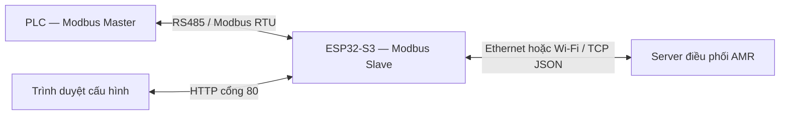

# Báo cáo phân tích firmware ESP32-S3 `new_01.ino`

- **Dự án:** Call_SDI
- **Ngày lập:** 17/11/2026
- **Mã nguồn được phân tích:** [new_01.ino](./new_01.ino)
- **Thư mục đang áp dụng:** `C:\Users\ESATECH\Desktop\new_01` (bản riêng, khác `Call_SDI\new_01`).
- **Phạm vi:** Đọc và phân tích mã nguồn; chưa biên dịch, nạp firmware hoặc kiểm thử với ESP32-S3, PLC và server thực tế.

## 1. Mục đích chương trình

Firmware sử dụng ESP32-S3 làm bộ trung gian trao đổi dữ liệu giữa PLC và server điều phối AMR:

- PLC trao đổi với ESP32 qua RS485 bằng Modbus RTU.
- ESP32 chủ động kết nối server qua TCP, gửi và nhận dữ liệu JSON.
- Trình duyệt truy cập web server trên ESP32 để cấu hình và theo dõi trạng thái kết nối.



ESP32 không trực tiếp đọc 18 cảm biến hàng qua GPIO trong chương trình này. Các trạng thái cảm biến được lấy từ vùng Coil do PLC ghi vào.

## 2. Thành phần phần cứng và thư viện

### 2.1. Phần cứng và chân kết nối

| Thành phần | Chức năng | Chân GPIO trong code |
|---|---|---|
| ESP32-S3 | Xử lý mạng, Modbus, web và các tác vụ | — |
| Ethernet W5500 qua SPI | Kết nối mạng LAN | CS: 10; IRQ: 21; RST: 14; SCK: 12; MISO: 13; MOSI: 11 |
| Wi-Fi tích hợp | Kết nối mạng không dây ở chế độ station | Không cần module Wi-Fi ngoài |
| UART1 nối bộ chuyển đổi RS485 | Giao tiếp Modbus RTU với PLC | TX: 17; RX: 8; DE/RE: 18 |
| LED trạng thái | Nhấp nháy báo tác vụ LED đang chạy | 3 |
| Flash nội bộ, LittleFS | Lưu cấu hình | Không cần chân ngoài |

Các chân trên là cấu hình trong mã nguồn, cần đối chiếu với sơ đồ đấu dây và board thực tế trước khi nạp.

### 2.2. Thư viện được sử dụng

| Thư viện | Vai trò |
|---|---|
| `Arduino.h` | Các hàm nền tảng Arduino |
| `WiFi.h` | Kết nối và quản lý Wi-Fi |
| `ETH.h` | Ethernet W5500 |
| `SPI.h` | Bus SPI cho W5500 |
| `WebServer.h` | Web server HTTP |
| `LittleFS.h` | Đọc/ghi file cấu hình trên flash |
| `ArduinoJson.h` | Phân tích và tạo JSON |
| `ModbusRTU.h` | Giao tiếp Modbus RTU qua RS485 |

Code chưa kèm thông tin phiên bản board package và thư viện để xác nhận môi trường biên dịch tương ứng.

## 3. Cấu hình và lưu trữ

### 3.1. Các nhóm cấu hình

| Cấu trúc | Nội dung |
|---|---|
| `NetworkConfig` | DHCP/IP tĩnh cho LAN và Wi-Fi; SSID, mật khẩu; subnet mask, gateway, DNS |
| `TCPConfig` | Bật/tắt TCP; tên thiết bị; IP server, cổng; chu kỳ gửi và thời gian thử kết nối lại |
| `RTUConfig` | Slave ID; baud rate; data bits; parity; stop bits |

### 3.2. Giá trị mặc định

| Thông số | Giá trị |
|---|---|
| LAN | IP tĩnh `192.168.0.17`, mask `255.255.255.0` |
| Gateway LAN | `192.168.0.1` |
| DNS LAN | `8.8.8.8` |
| Wi-Fi | Bật, dùng DHCP |
| SSID / mật khẩu Wi-Fi | Để trống; chưa kết nối Wi-Fi khi giữ mặc định |
| IP Wi-Fi dự phòng trong cấu hình | `192.168.0.18`, chỉ dùng khi cấu hình IP tĩnh |
| Gateway / mask / DNS Wi-Fi | `192.168.0.1` / `255.255.255.0` / `8.8.8.8` |
| TCP | Bật |
| Tên thiết bị | `Call Device` |
| Server TCP | `192.168.0.100:502` |
| Chu kỳ gửi JSON (`tcpCfg.timeout`) | 3000 ms |
| Khoảng thử kết nối TCP lại | 3000 ms |
| Modbus RTU | Slave ID 1; 9600 baud; 8N1 |
| Serial debug | 115200 baud |

### 3.3. Cách lưu và nạp

- File cấu hình thực tế là **`/config.json` trong LittleFS trên ESP32**.
- `setDefaultConfig()` thiết lập các giá trị mặc định.
- `loadConfig()` đọc file và cập nhật các nhóm cấu hình.
- Nếu không có file hoặc JSON bị lỗi, chương trình dùng mặc định và lưu lại.
- `saveConfig()` ghi cấu hình JSON xuống flash.
- `applyConfig()` cập nhật cấu hình trong RAM và kiểm tra một số giá trị như slave ID, data bits, parity, stop bits.

Không cần file `Config.txt` trong thư mục sketch để thực hiện luồng lưu/nạp này.

## 4. Giao tiếp PLC bằng Modbus RTU

### 4.1. Vai trò và vùng dữ liệu

Hàm `startModbus()` khởi tạo UART1, chân điều khiển DE/RE và Modbus slave.

**PLC phải đóng vai trò Modbus master**, chủ động gửi yêu cầu đọc/ghi đến ESP32.

| Vùng | Khởi tạo trong code | Công dụng hiện tại |
|---|---|---|
| Coil | 50 bit, địa chỉ 0–49, giá trị ban đầu false | PLC ghi trạng thái máy; ESP32 lấy dữ liệu gửi server |
| Discrete Input (`Ists`) | 10 bit, địa chỉ 0–9, giá trị ban đầu false | ESP32 cập nhật trạng thái từ server; PLC đọc |

Code hiện dùng Coil 0–23 và Discrete Input 0–8. Các địa chỉ trong báo cáo là địa chỉ bắt đầu từ **0 theo mã nguồn**; cần đối chiếu cách hiển thị địa chỉ của phần mềm PLC.

### 4.2. Chiều PLC → ESP32 → server

| Địa chỉ Coil | Trường JSON | Ý nghĩa tín hiệu |
|---|---|---|
| 0 | `READY` | Máy sẵn sàng |
| 1 | `CALL` | Gọi AMR |
| 2 | `EMG` | Dừng khẩn cấp |
| 3 | `CART_R  READY` | Giá/khay hàng phải sẵn sàng |
| 4 | `CART_L  READY` | Giá/khay hàng trái sẵn sàng |
| 5 | `LOAD TRAY` | Đang load tray |
| 6–14 | `SS CART_R` | 9 trạng thái vị trí hàng bên phải |
| 15–23 | `SS CART_L` | 9 trạng thái vị trí hàng bên trái |

Hai mảng cảm biến dùng **thứ tự ánh xạ tùy chỉnh**, không phải địa chỉ tăng dần. Mỗi phần tử là số `1` hoặc `0`. Thứ tự thực tế trong bản này:

| Phần tử JSON (index) | Coil `SS CART_R` | Coil `SS CART_L` |
|---|---|---|
| 0 | 8 | 17 |
| 1 | 11 | 20 |
| 2 | 14 | 23 |
| 3 | 7 | 16 |
| 4 | 10 | 19 |
| 5 | 13 | 22 |
| 6 | 6 | 15 |
| 7 | 9 | 18 |
| 8 | 12 | 21 |

Các mảng địa chỉ tăng dần còn xuất hiện dưới dạng comment `//const` nên không được thực thi. Khi sửa thứ tự cảm biến, chỉnh hai mảng `R_Coil` và `L_Coil` đang hoạt động trong `tcpTaskProcess()`, rồi đối chiếu với PLC và server. Chưa có sơ đồ PLC để xác nhận vị trí vật lý hàng/cột của từng phần tử.

### 4.3. Chiều server → ESP32 → PLC

| Địa chỉ Discrete Input | Trường JSON | Ý nghĩa tín hiệu |
|---|---|---|
| 0 | `READY` | AMR sẵn sàng |
| 1 | `ERROR` | AMR có lỗi |
| 2 | `CART_R` | AMR lấy hàng bên phải |
| 3 | `CART_L` | AMR lấy hàng bên trái |
| 4 | `ULOADING` | AMR trả hàng vào máy |
| 5 | `DONE` | Hoàn thành trả hàng |
| 6 | `MOVING` | AMR đang di chuyển |
| 7 | `BATTERY` | AMR đủ pin hoạt động |
| 8 | `EMG` | AMR dừng khẩn cấp |

Chương trình chỉ cập nhật bit khi JSON có trường tương ứng. Nếu thiếu trường, bit đó giữ giá trị trước đó.

## 5. Giao tiếp TCP và định dạng JSON

### 5.1. Kết nối

- ESP32 là **TCP client**, chủ động kết nối đến server được cấu hình.
- `tcpConnect()` giới hạn khoảng thời gian giữa các lần thử kết nối bằng `tcpCfg.reconnect`.
- `tcpTaskProcess()` kiểm tra kết nối, nhận JSON và gửi trạng thái định kỳ.
- Khi phát hiện socket mất kết nối, chương trình chuyển sang luồng thử kết nối lại.

**Cổng mặc định 502 không có nghĩa là Modbus TCP. Giao thức ứng dụng trong code này là JSON qua TCP.**

### 5.2. Định dạng bản tin

Mỗi bản tin JSON được kết thúc bằng ký tự xuống dòng `\n`. Khi truyền thực tế, mỗi JSON cần nằm trên một dòng.

Ví dụ ESP32 gửi server:

```json
{"id":"Call Device","READY":true,"CALL":false,"EMG":false,"CART_R  READY":true,"CART_L  READY":true,"LOAD TRAY":false,"SS CART_R":[1,0,0,0,0,0,0,0,0],"SS CART_L":[0,0,0,0,0,0,0,0,1]}
```

Ví dụ server gửi ESP32:

```json
{"READY":true,"ERROR":false,"CART_R":false,"CART_L":false,"ULOADING":false,"DONE":false,"MOVING":false,"BATTERY":true,"EMG":false}
```

Tên khóa phải khớp chính xác:

- `CART_R  READY` và `CART_L  READY` có **hai dấu cách** trước `READY`.
- `ULOADING` được giữ nguyên đúng theo code hiện tại.
- `READY` và `EMG` có ý nghĩa theo chiều truyền: chiều gửi là trạng thái máy; chiều nhận là trạng thái AMR.

### 5.3. Chu kỳ và log

- Chu kỳ gửi mặc định là 3 giây.
- Code chặn chu kỳ gửi nhỏ hơn 10 ms bằng cách nâng lên 10 ms.
- `tcpClient.setTimeout(100)` đặt timeout đọc của stream là 100 ms.
- JSON nhận được và giá trị từng Discrete Input sau cập nhật được in ra Serial.
- JSON không phân tích được sẽ bị bỏ qua.

## 6. Web cấu hình và API

### 6.1. Giao diện

Giao diện HTML/CSS/JavaScript được nhúng trong biến `INDEX_HTML` bằng `PROGMEM` ngay trong sketch.

Web server chạy ở cổng **80**. Khi thiết bị có IP và truy cập được qua mạng, có thể mở trình duyệt đến IP đó. Với LAN mặc định, địa chỉ là `http://192.168.0.17/`.

Giao diện hỗ trợ:

- Cấu hình LAN và Wi-Fi.
- Cấu hình TCP client và tên thiết bị.
- Cấu hình Modbus RTU/RS485.
- Lưu cấu hình.
- Xem IP, MAC, mask, gateway, DNS, trạng thái mạng, RSSI Wi-Fi, trạng thái TCP và cấu hình serial.
- Tự cập nhật trạng thái mỗi 2 giây.
- Khởi động lại thiết bị.

Trang trạng thái hiện chưa hiển thị từng Coil/Discrete Input hoặc xác nhận PLC đang giao tiếp thành công.

### 6.2. API

| Phương thức | Đường dẫn | Hàm xử lý | Chức năng |
|---|---|---|---|
| GET | `/` | `handleRoot()` | Trả giao diện web |
| GET | `/api/config` | `handleGetConfig()` | Trả cấu hình hiện tại |
| POST | `/api/config` | `handleSetConfig()` | Nhận JSON, cập nhật và lưu cấu hình |
| GET | `/api/status` | `handleStatus()` | Trả trạng thái mạng, TCP và cấu hình serial |
| POST | `/api/reboot` | `handleReboot()` | Trả phản hồi, chờ 500 ms rồi gọi `ESP.restart()` |

## 7. Khởi động và các tác vụ FreeRTOS

### 7.1. Trình tự khởi động

Trong `setup()`:

1. Khởi tạo Serial debug ở 115200 baud.
2. Khởi tạo LittleFS.
3. Thiết lập mặc định rồi đọc cấu hình đã lưu.
4. Đăng ký callback sự kiện mạng.
5. Khởi động Ethernet W5500.
6. Khởi động Wi-Fi nếu được bật và có SSID.
7. Khởi động web server.
8. Tạo 5 tác vụ FreeRTOS.

Modbus được khởi tạo bên trong `modbusTask()`. Hàm `loop()` chỉ chờ 1000 ms mỗi vòng; các công việc chính nằm trong các tác vụ.

### 7.2. Phân chia tác vụ

| Tác vụ | Core | Priority | Thời gian chờ cuối vòng | Công việc |
|---|---|---|---|---|
| `networkTask` | 0 | 2 | 500 ms | Kiểm tra Wi-Fi; thử kết nối lại theo khoảng 5000 ms khi bị mất |
| `tcpTask` | 0 | 3 | 5 ms | Xử lý kết nối, gửi và nhận TCP |
| `modbusTask` | 1 | 5 | 1 ms | Gọi `mb.task()` để xử lý yêu cầu Modbus |
| `webTask` | 1 | 2 | 2 ms | Gọi `server.handleClient()` |
| `statusTask` | 1 | 1 | 250 ms | Đảo trạng thái LED GPIO 3 |

Thời gian chờ trên là lệnh `vTaskDelay()` trong code, không phải cam kết chu kỳ xử lý chính xác vì còn phụ thuộc thời gian chạy tác vụ và các thao tác chờ I/O.

LED đổi trạng thái mỗi 250 ms, tương ứng một chu kỳ sáng/tắt khoảng 500 ms. LED không được điều khiển theo trạng thái kết nối PLC hoặc server.

## 8. Các điểm cần chú ý trong triển khai hiện tại

| Điểm quan sát được | Ảnh hưởng hoặc ý nghĩa |
|---|---|
| `tcpCfg.timeout` được dùng làm chu kỳ gửi | Tên biến dễ gây hiểu nhầm là thời gian phát hiện mất phản hồi server |
| `lastTCPActivity` được cập nhật nhưng chưa dùng để kiểm tra hết thời gian chờ | Chưa có cơ chế riêng phát hiện server vẫn giữ socket nhưng không gửi dữ liệu |
| Không tự xóa Discrete Input khi mất TCP | PLC có thể tiếp tục đọc trạng thái AMR cũ |
| JSON thiếu trường sẽ giữ bit cũ | Server cần thống nhất cơ chế gửi đầy đủ hoặc cập nhật từng phần |
| Nhận dữ liệu bằng `readStringUntil('\n')`, timeout đọc 100 ms | Nếu bản tin tới chậm hoặc bị chia nhỏ quá lâu, có thể đọc một phần JSON và bỏ qua do lỗi phân tích; chưa có bộ đệm ghép bản tin qua các lần đọc |
| Lưu cấu hình RS485 chưa gọi lại `startModbus()` | Cần reboot để UART và Modbus sử dụng cấu hình mới |
| Đổi IP/cổng server chưa chủ động đóng socket cũ | Kết nối đang mở có thể tiếp tục dùng server cũ đến khi ngắt hoặc reboot |
| Có Ethernet và Wi-Fi nhưng chưa có logic riêng chọn ưu tiên/chuyển dự phòng | Không thể kết luận đã có cơ chế tự chuyển LAN–Wi-Fi theo yêu cầu vận hành |
| Có khai báo `ETH_RECONNECT_INTERVAL` và `lastETHCheck`, chưa có luồng sử dụng tương ứng | Chưa thấy tác vụ kiểm tra/khởi tạo lại Ethernet theo khoảng thời gian này |
| `getSerialConfig()` ở chế độ 7 data bits luôn chọn 1 stop bit | Chọn 7 data bits và 2 stop bits chưa được áp dụng đúng theo lựa chọn |
| Các tác vụ dùng chung `mb` và cấu hình, chưa thấy mutex trong sketch | Cần kiểm tra tính an toàn truy cập đồng thời khi thử tải và thay đổi cấu hình |

Các điểm trên được rút ra từ mã nguồn. Chưa có kết quả kiểm thử để xác nhận mức độ ảnh hưởng trên thiết bị thực tế.

## 9. Hạng mục kiểm thử đề xuất

1. **Biên dịch:** xác nhận board ESP32-S3, phiên bản Arduino core và các thư viện tương thích.
2. **Modbus:** PLC ghi lần lượt Coil 0–23; kiểm tra đúng trường và đúng thứ tự mảng trong JSON gửi lên server.
3. **Chiều phản hồi:** server đổi lần lượt 9 trường trạng thái; PLC đọc Discrete Input 0–8 và đối chiếu.
4. **Định dạng TCP:** thử bản tin có `\n`, JSON lỗi, thiếu trường và bản tin bị chia nhỏ.
5. **Mất kết nối:** rút LAN, mất Wi-Fi, tắt server; kiểm tra kết nối lại và giá trị PLC còn đọc được.
6. **Cấu hình:** lưu, reboot và mất/cấp nguồn lại; kiểm tra thông số mạng, server và RS485 đã được giữ lại.
7. **Chạy đồng thời:** trao đổi Modbus/TCP trong khi truy cập web, quan sát độ ổn định và thời gian đáp ứng.

## 10. Đánh giá phạm vi chức năng

`new_01.ino` đã có các khối chính cho một gateway PLC–server: Modbus RTU slave, TCP JSON client, Ethernet/Wi-Fi, web cấu hình, lưu cấu hình LittleFS, log debug và các tác vụ FreeRTOS.

Code chủ yếu chuyển đổi dữ liệu giữa hai phía. Chưa thấy logic điều phối hành trình AMR hoặc trình tự điều khiển máy trong sketch; các quyết định đó cần được thực hiện ở PLC và/hoặc server theo thiết kế hệ thống.

## 11. Tra cứu chú thích trong mã nguồn

Mã nguồn đã được bổ sung chú thích tiếng Việt có tiền tố `[HUONG DAN]`. Dùng chức năng tìm kiếm của Arduino IDE để đến các mục:

| Nhãn | Phần chương trình | Nơi chỉnh sửa thường gặp |
|---|---|---|
| `[01]` | Thư viện và phần cứng | Chân W5500, RS485, LED; cổng web |
| `[02]` | Cấu trúc cấu hình | Các trường LAN/Wi-Fi/TCP/RTU |
| `[03]` | Mặc định | IP, SSID, tên thiết bị, server, thông số serial |
| `[04]` | Lưu/nạp | JSON cấu hình trong LittleFS |
| `[05]` | Modbus RTU | Kiểu serial, slave ID, dung lượng Coil/Ists |
| `[06]` | Mạng | Khởi tạo Ethernet, Wi-Fi và callback sự kiện |
| `[07]` | TCP và ánh xạ tín hiệu | Trường JSON, địa chỉ và thứ tự cảm biến |
| `[08]` | API cấu hình | Đọc, cập nhật, lưu cấu hình, trạng thái và reboot |
| `[09]` | Giao diện web | HTML/CSS/JavaScript nhúng trong sketch |
| `[10]` | Đăng ký API | Đường dẫn và hàm xử lý HTTP |
| `[11]` | Khởi động | Trình tự setup và khởi tạo tác vụ |
| `[12]` | FreeRTOS | Các vòng xử lý Modbus, web, TCP, mạng, LED |

Lần cập nhật này bổ sung chú thích và sửa báo cáo theo thứ tự cảm biến thực tế; không thay đổi logic điều khiển hoặc ánh xạ đang hoạt động của firmware.
