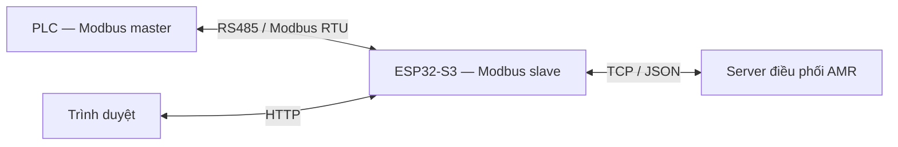

# Cơ sở và lộ trình xây dựng chương trình ESP32-S3

- **Dự án:** `new_01` — bộ trung gian PLC–server/AMR.
- **Ngày lập:** 17/11/2026.
- **Mã nguồn tham chiếu:** [new_01.ino](./new_01.ino).
- **Tài liệu phân tích chức năng:** [BAO_CAO_PHAN_TICH_NEW_01.md](./BAO_CAO_PHAN_TICH_NEW_01.md).
- **Mục đích:** Giải thích cần bắt đầu từ đâu, căn cứ vào thông tin nào để viết chương trình và thứ tự triển khai phù hợp cho người học.

## 1. Bắt đầu từ yêu cầu hệ thống

Để xây dựng chương trình này, trước hết cần có **yêu cầu hoạt động, bảng tín hiệu giao tiếp và sơ đồ phần cứng**. Sau đó mới chọn thư viện và viết code.

Các câu lệnh trong chương trình là cách biến các yêu cầu đó thành hành động trên ESP32.

Với dự án này, ESP32 cần thực hiện:

1. Nhận trạng thái máy từ PLC qua RS485.
2. Gửi các trạng thái đó lên server bằng JSON qua TCP.
3. Nhận trạng thái AMR từ server.
4. Cung cấp trạng thái AMR để PLC đọc.
5. Cho phép cấu hình thiết bị bằng trình duyệt.

Kiến trúc tổng thể:



Vai trò **PLC là Modbus master, ESP32 là Modbus slave và ESP32 là TCP client** phải được thống nhất với người lập trình PLC và server.

Trước khi lập trình, cần trả lời rõ:

- Thiết bị nào tạo từng tín hiệu? Thiết bị nào sử dụng tín hiệu đó?
- Tín hiệu là trạng thái được giữ liên tục hay yêu cầu cần xác nhận?
- Khi nào bật, tắt hoặc xóa yêu cầu gọi AMR?
- Các giá trị `true`, `false`, `1`, `0` có ý nghĩa gì?
- Khi mất kết nối, phía PLC và server phải xử lý dữ liệu cũ như thế nào?

Các quy tắc này thuộc yêu cầu vận hành, không thể suy ra đầy đủ chỉ từ tên biến trong code.

## 2. Tài liệu đầu vào trong dự án

Trong bộ dự án `Call_SDI` có hai tài liệu liên quan:

| Tài liệu | Nội dung có thể sử dụng |
|---|---|
| [Interface PLC AMR.xlsx](<../Call_SDI/Interface PLC AMR.xlsx>) | Danh sách tín hiệu PLC–AMR và các vị trí cảm biến hàng |
| [CALL_SDI.txt](../Call_SDI/CALL_SDI.txt) | Tên trường JSON, chiều truyền và ý nghĩa `true`/`false` |

Các liên kết trên giả định thư mục `Call_SDI` và `new_01` cùng nằm trên Desktop như bố trí hiện tại.

### 2.1. Thông tin còn phải bổ sung

File Excel hiện chưa ghi địa chỉ trong các cột **Device**. Cột số thứ tự không đủ để khẳng định địa chỉ Coil hoặc Discrete Input tương ứng.

Cần lập một bảng giao tiếp được các bên thống nhất, bao gồm:

- Tên và ý nghĩa tín hiệu.
- Chiều truyền, bên tạo và bên sử dụng dữ liệu.
- Loại vùng nhớ và địa chỉ Modbus.
- Tên trường JSON và kiểu dữ liệu.
- Ý nghĩa của từng giá trị.
- Thứ tự phần tử trong các mảng cảm biến.
- Quy tắc xác nhận, xóa yêu cầu và xử lý mất liên lạc.

### 2.2. Ví dụ bảng ánh xạ theo code hiện tại

| Tín hiệu | Bên tạo dữ liệu | Vùng nhớ ESP32 | Trường JSON |
|---|---|---|---|
| Máy sẵn sàng | PLC | Coil 0 | `READY` trong bản tin gửi server |
| Gọi AMR | PLC | Coil 1 | `CALL` |
| Máy dừng khẩn cấp | PLC | Coil 2 | `EMG` trong bản tin gửi server |
| AMR sẵn sàng | Server | Discrete Input 0 | `READY` trong bản tin nhận từ server |
| AMR đang di chuyển | Server | Discrete Input 6 | `MOVING` |
| AMR đủ pin | Server | Discrete Input 7 | `BATTERY` |

Các địa chỉ trên bắt đầu từ **0 theo mã nguồn**. Đây là mô tả bản code hiện tại, cần đối chiếu với chương trình PLC thực tế.

Địa chỉ Coil không phải do thư viện tự quy định. Người thiết kế hệ thống phải thống nhất chúng rồi mới đưa vào code.

### 2.3. Các điểm cần thống nhất trong tài liệu hiện có

- Excel ghi **LOW BATTERY**, còn `CALL_SDI.txt` quy định **`BATTERY=true` là đủ pin, `false` là pin yếu**. Code hiện chuyển thẳng `BATTERY` vào Discrete Input 7, không đảo bit.
- JSON và code có tín hiệu AMR `EMG` ở Discrete Input 8, trong khi danh sách chiều AMR → PLC của Excel chưa liệt kê tín hiệu này.
- Thứ tự cảm biến đang dùng trong code là ánh xạ tùy chỉnh. Excel chưa cung cấp địa chỉ để xác nhận từng phần tử ứng với vị trí vật lý nào.

Những nội dung này cần được làm rõ ở bước thiết kế giao tiếp, vì chương trình có thể chạy bình thường nhưng truyền sai ý nghĩa tín hiệu nếu quy ước giữa các bên khác nhau.

## 3. Cơ sở phần cứng và thông số kết nối

| Thông tin cần biết | Dùng để viết phần nào? |
|---|---|
| Loại board ESP32-S3 và sơ đồ chân thực tế | Chọn board, cấu hình ngoại vi và GPIO |
| W5500 nối vào các chân SPI nào | Các `#define ETH_*`, `ethSPI.begin()`, `ETH.begin()` |
| RS485 nối UART nào, chân TX/RX/DE-RE nào | `RS485Serial.begin()`, `mb.begin()` |
| Baud, parity, stop bit, slave ID của PLC | `getSerialConfig()`, `mb.slave()` |
| IP, mask, gateway, DHCP của mạng | `startEthernet()`, `startWiFi()` |
| IP/cổng server và định dạng bản tin | `tcpConnect()`, `tcpTaskProcess()` |
| Yêu cầu giữ cấu hình sau khi mất điện | `saveConfig()`, `loadConfig()` với LittleFS |

Các chân GPIO phải dựa trên sơ đồ đấu dây của board thực tế. Thông số RS485 phải khớp phía PLC.

Ví dụ trong bản hiện tại:

- W5500: CS 10, IRQ 21, RST 14, SCK 12, MISO 13, MOSI 11.
- RS485: UART1, TX 17, RX 8, DE/RE 18.
- Modbus mặc định: slave ID 1, 9600 baud, 8N1.
- Server TCP mặc định: `192.168.0.100:502`.

Các giá trị mặc định có thể bị cấu hình đã lưu trong `/config.json` ghi đè khi khởi động. Cổng 502 trong chương trình này đang truyền **JSON qua TCP**, không phải Modbus TCP.

## 4. Chuyển yêu cầu thành câu lệnh

Ví dụ yêu cầu:

> PLC ghi yêu cầu gọi AMR vào Coil 1; ESP32 gửi yêu cầu này lên server.

Ta triển khai thành các bước sau. Đoạn code dưới đây là minh họa trích gọn, cần có khai báo và khởi tạo tương ứng trong chương trình đầy đủ.

```cpp
// Tạo vùng Coil để PLC có thể ghi.
mb.addCoil(0, false, 50);

// Lấy giá trị Coil 1 đưa vào bản tin JSON.
doc["CALL"] = mb.Coil(1);

// Chuyển JSON thành chuỗi rồi gửi server, kết thúc bằng xuống dòng.
serializeJson(doc, json);
tcpClient.print(json);
tcpClient.print('\n');
```

Trong ví dụ này:

- **50 Coil** là dung lượng vùng nhớ được người viết lựa chọn; không phải yêu cầu bắt buộc của mọi ứng dụng.
- **Coil 1 tương ứng `CALL`** là quy ước giao tiếp cần thống nhất.
- `mb.Coil(1)` đọc bit trong bộ nhớ Modbus cục bộ trên ESP32 do PLC ghi vào.
- Ký tự `\n` là quy ước phân cách bản tin đang dùng giữa ESP32 và server.

Với chiều ngược lại, yêu cầu “server báo AMR đang di chuyển để PLC đọc” được triển khai như sau:

```cpp
if (doc.containsKey("MOVING")) {
    bool moving = doc["MOVING"];
    mb.Ists(6, moving);
}
```

PLC sau đó chủ động đọc Discrete Input 6 từ ESP32. Sketch không tự điều khiển hành trình AMR; nó chuyển dữ liệu giữa hai phía.

## 5. Kiến thức và thư viện cần học

| Kiến thức | Ứng dụng trong dự án |
|---|---|
| C/C++: biến, hàm, điều kiện, vòng lặp, mảng, `struct` | Tổ chức dữ liệu, cấu hình và xử lý tín hiệu |
| Arduino: `setup()`, `loop()`, Serial, GPIO | Khởi động và kiểm tra phần cứng |
| Chia module `.h`/`.cpp` | Tách cấu hình, Modbus, mạng, TCP và web để dễ sửa |
| UART, SPI, RS485 | Kết nối và sử dụng ngoại vi |
| Modbus RTU | Phân biệt master/slave, Coil/Discrete Input và địa chỉ |
| TCP và JSON | Kết nối server, tạo/phân tích bản tin và xác định ranh giới bản tin |
| HTTP, HTML, CSS, JavaScript | Trang cấu hình và các API |
| LittleFS | Lưu cấu hình trên flash |
| FreeRTOS | Chia tác vụ, thời gian chờ, độ ưu tiên và dữ liệu dùng chung |

Không cần tự viết toàn bộ các giao thức từ đầu. Code hiện tại sử dụng các thư viện nền tảng:

| Thư viện | Phần việc cung cấp |
|---|---|
| `ModbusRTU` | Xử lý giao thức Modbus RTU |
| `ArduinoJson` | Tạo và phân tích JSON |
| `WiFi`, `ETH`, `SPI` | Các API mạng và bus phần cứng |
| `WebServer` | Nhận và trả lời yêu cầu HTTP |
| `LittleFS` | Đọc/ghi file trong flash |

Phần người lập trình viết là cách cấu hình, kết nối và phối hợp các khối này theo yêu cầu của máy. Cần ghi lại phiên bản board package và thư viện đã biên dịch thành công để tái tạo môi trường về sau.

## 6. Thứ tự triển khai và kết quả cần kiểm chứng

| Bước | Nội dung thực hiện | Kết quả cần quan sát được |
|---|---|---|
| 1 | Nạp chương trình cơ bản cho ESP32-S3, mở Serial và nháy LED | Board chạy, có log, LED thay đổi đúng dự kiến |
| 2 | Khởi tạo Modbus slave với một Coil và một Discrete Input | PLC ghi Coil được; ESP32 in đúng giá trị; PLC đọc được bit phản hồi |
| 3 | Kết nối LAN hoặc Wi-Fi | Có IP và có thể liên lạc trong mạng dự kiến |
| 4 | Kết nối TCP, gửi JSON cố định, nhận JSON mẫu | Hai phía nhận đúng nội dung và ranh giới bản tin |
| 5 | Nối dữ liệu Modbus với TCP | PLC ghi bit thì JSON đổi đúng; server gửi bit thì PLC đọc đúng |
| 6 | Bổ sung đủ tín hiệu và 18 cảm biến | Từng tín hiệu, từng vị trí mảng được đối chiếu đúng với PLC/server |
| 7 | Thêm cấu hình LittleFS và web | Lưu được cấu hình, reboot vẫn giữ thông số, giao diện gọi đúng API |
| 8 | Tổ chức FreeRTOS và kiểm tra đồng thời | Modbus, TCP và web cùng hoạt động; hành vi mất/kết nối lại phù hợp yêu cầu |

Ở mỗi bước, cần có kết quả quan sát được trước khi thêm phần tiếp theo. Ví dụ PLC ghi `CALL=true` thì phải nhìn thấy đúng giá trị trên ESP32 trước khi kiểm tra việc gửi lên server.

Trong giai đoạn học, có thể hoàn thành các thử nghiệm nhỏ bằng `setup()`/`loop()` trước khi chuyển sang mô hình nhiều tác vụ. Khi chia FreeRTOS, cần hiểu phần dữ liệu nào được nhiều tác vụ truy cập.

## 7. Giữ đúng thứ tự cảm biến của bản hiện tại

Hai mảng đang hoạt động trong `tcpTaskProcess()` là:

```cpp
const int R_Coil[] = {8, 11, 14, 7, 10, 13, 6, 9, 12};
const int L_Coil[] = {17, 20, 23, 16, 19, 22, 15, 18, 21};
```

Đây là thứ tự địa chỉ để tạo 9 phần tử JSON cho mỗi bên, không phải danh sách chân GPIO và không phải thứ tự địa chỉ tăng dần.

Ví dụ phần tử JSON có index 0 lấy từ Coil 8 bên phải và Coil 17 bên trái. Khi kiểm thử, cần đổi từng bit riêng lẻ để xác nhận đúng phần tử ở phía server.

## 8. Bài thực hành đầu tiên

Mục tiêu ban đầu phù hợp là **chỉ dùng PLC và ESP32 để kiểm tra hai chiều Modbus**:

1. Đấu RS485 và thiết lập cùng baud, parity, stop bit, slave ID.
2. ESP32 khởi tạo một vùng Coil và một vùng Discrete Input.
3. PLC ghi Coil 1 lần lượt bằng `false` rồi `true`.
4. ESP32 in giá trị Coil 1 ra Serial để kiểm chứng.
5. ESP32 đặt một Discrete Input lần lượt bằng `false` rồi `true`.
6. PLC chủ động đọc và hiển thị đúng các giá trị đó.

Sau khi hai chiều này chạy đúng, bổ sung TCP để chuyển cùng các bit đó đến và từ server. Đây là bước nối trực tiếp kiến thức Modbus với chương trình gateway hiện tại.
